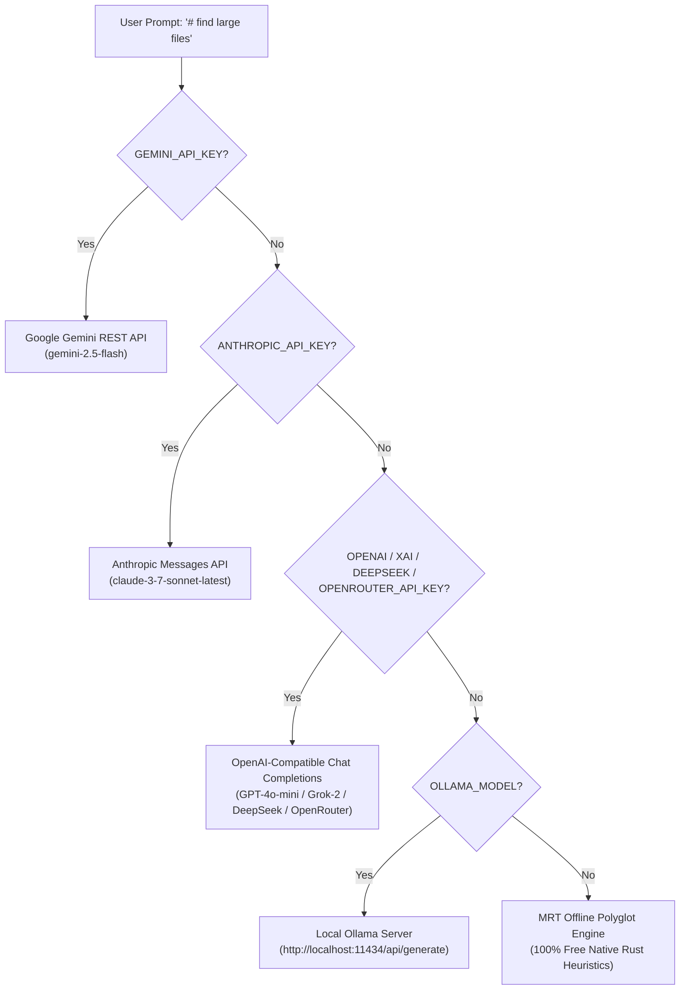

# 🧠 In-Depth Multi-Provider AI & Agent Guide (`mrt-ai`)

[`crates/mrt-ai`](../crates/mrt-ai) powers the natural-language command bar (`# <query>` or `? <query>`) and the automatic **AI Error Triage** engine in **Modern Rust Terminal (MRT)**.

MRT is built on a core philosophy: **support every AI provider without lock-in, and always work 100% free and offline when no API key is set.**

---

## 1. Provider Resolution Order

When a user types `# <request>` or `? <request>` in MRT, `translate_nl_to_command()` checks configured environment variables in the following order and automatically falls back if a key is absent or a network call fails:



### Environment Variables Reference

| Provider | Environment Variable | Endpoint Used | Default Model |
| :--- | :--- | :--- | :--- |
| **Google Gemini** | `GEMINI_API_KEY` | `generativelanguage.googleapis.com/v1beta` | `gemini-2.5-flash` |
| **Anthropic Claude** | `ANTHROPIC_API_KEY` | `https://api.anthropic.com/v1/messages` | `claude-3-7-sonnet-latest` |
| **OpenAI** | `OPENAI_API_KEY` | `https://api.openai.com/v1/chat/completions` | `gpt-4o-mini` |
| **xAI Grok** | `XAI_API_KEY` | `https://api.x.ai/v1/chat/completions` | `grok-2-latest` |
| **DeepSeek** | `DEEPSEEK_API_KEY` | `https://api.deepseek.com/chat/completions` | `deepseek-chat` |
| **OpenRouter** | `OPENROUTER_API_KEY` | `https://openrouter.ai/api/v1/chat/completions` | `openrouter/auto` |
| **Local Ollama** | `OLLAMA_MODEL` (+ optional `OLLAMA_HOST`) | `http://localhost:11434/api/generate` | User-specified (e.g. `qwen2.5-coder`) |

---

## 2. Shell-Aware Context Injection

Every AI prompt constructed by `build_system_prompt()` includes:
1. **Target OS** (`windows`, `macos`, `linux`)
2. **Active Tab's `ShellProfile`** (e.g., `Command Prompt / Batch (cmd.exe)` vs `Windows PowerShell` vs `Git Bash`)
3. **Current Working Directory (`cwd`)**
4. **Connected MCP Tool Names** from `McpHostManager`

Furthermore, when the **Offline Polyglot Engine** (`heuristic_shell_translator`) handles a request, it branches on `shell.kind` so the generated command leverages MRT's structured viewers:
- In **PowerShell**, `# list all files` generates:
  ```powershell
  Get-ChildItem -Force | Select-Object Mode, LastWriteTime, Length, Name | ConvertTo-Json
  ```
  *(which MRT automatically renders as a collapsible JSON Tree!)*
- In **CMD / Batch**, `# list all files` generates:
  ```cmd
  dir /a
  ```
- In **Bash / Git Bash / WSL / Zsh**, `# list all files` generates:
  ```bash
  ls -la
  ```

---

## 3. Automatic Error Triage (`diagnose_command_error`)

Whenever a command exits with a non-zero status code (`exit_code != 0`), MRT displays a **✨ Diagnose Error** button in the block header.

`diagnose_command_error(command, output, exit_code, shell)` inspects the command, stderr/stdout text, and active `ShellKind` to detect common cross-shell issues and offer a one-click **▶ Run Fix** button:
- Running `ls` inside Windows `cmd.exe` -> Explains that `ls` is POSIX/PowerShell and suggests `dir`.
- Running `export VAR=val` inside `cmd.exe` or `powershell` -> Suggests `set VAR=val` (for Batch) or `$env:VAR = "val"` (for PowerShell).
- Unrecognized command / `command not found` -> Suggests `Get-Command *<bin>*` (PowerShell), `where <bin>` (CMD), or `which <bin>` (Bash).
- Missing path / directory -> Suggests listing the current directory in the active shell's native syntax.
