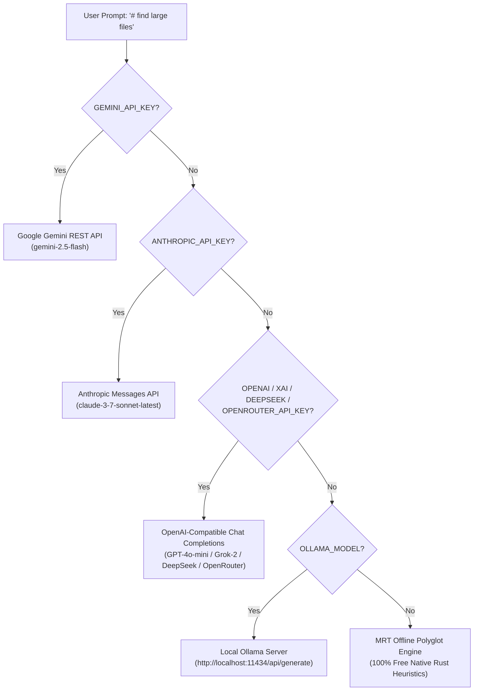

# In-Depth Multi-Provider AI & Agent Guide (`mrt-ai`)

[`crates/mrt-ai`](../crates/mrt-ai) powers the natural-language command bar (`# <query>` or `? <query>`) and the automatic **AI Error Triage** engine in **Modern Rust Terminal (MRT)**.

MRT is provider-agnostic and falls back to a built-in offline heuristic engine when no API key is configured.

---

## 1. Provider Resolution Order

When a user types `# <request>` or `? <request>` in MRT, `translate_nl_to_command()` checks configured environment variables in the following order and automatically falls back if a key is absent or a network call fails:



`plan_ai_backends()` builds this list. The `[ai]` section of the [configuration file](USER_GUIDE.md#6-configuration-file) can change it (the GUI passes it in with `set_ai_preferences()`):

- `provider = "<name>"` moves that provider to the front; the others keep their order as fallbacks. `provider = "offline"` skips every network provider.
- `model` replaces the default model of the provider named in `provider`.
- `ollama_endpoint` sets the Ollama URL, and `model` with `provider = "ollama"` enables Ollama without `OLLAMA_MODEL`.

Environment variables win: keys come only from the environment, and `OLLAMA_MODEL` / `OLLAMA_HOST` override `model` / `ollama_endpoint`.

### Environment Variables Reference

| Provider | Environment Variable | Endpoint Used | Default Model |
| :--- | :--- | :--- | :--- |
| **Google Gemini** | `GEMINI_API_KEY` | `generativelanguage.googleapis.com/v1beta` | `gemini-2.5-flash` |
| **Anthropic Claude** | `ANTHROPIC_API_KEY` | `https://api.anthropic.com/v1/messages` | `claude-3-7-sonnet-latest` |
| **OpenAI** | `OPENAI_API_KEY` | `https://api.openai.com/v1/chat/completions` | `gpt-4o-mini` |
| **xAI Grok** | `XAI_API_KEY` | `https://api.x.ai/v1/chat/completions` | `grok-2-latest` |
| **DeepSeek** | `DEEPSEEK_API_KEY` | `https://api.deepseek.com/chat/completions` | `deepseek-chat` |
| **OpenRouter** | `OPENROUTER_API_KEY` | `https://openrouter.ai/api/v1/chat/completions` | `openrouter/auto` |
| **Local Ollama** | `OLLAMA_MODEL` (+ optional `OLLAMA_HOST`) | `http://localhost:11434/api/generate` | User-specified (e.g. `qwen2.5-coder`) |

---

## 2. Shell-Aware Context Injection

Every AI prompt constructed by `build_system_prompt()` includes:
1. **Target OS** (`windows`, `macos`, `linux`)
2. **Active Tab's `ShellProfile`** (e.g., `Command Prompt / Batch (cmd.exe)` vs `Windows PowerShell` vs `Git Bash`)
3. **Current Working Directory (`cwd`)**
4. **Connected MCP Tool Names** from `McpHostManager`

Furthermore, when the **Offline Polyglot Engine** (`heuristic_shell_translator`) handles a request, it branches on `shell.kind` so the generated command leverages MRT's structured viewers:
- In **PowerShell**, `# list all files` generates:
  ```powershell
  Get-ChildItem -Force | Select-Object Mode, LastWriteTime, Length, Name | ConvertTo-Json
  ```
  *(which MRT automatically renders as a collapsible JSON Tree!)*
- In **CMD / Batch**, `# list all files` generates:
  ```cmd
  dir /a
  ```
- In **Bash / Git Bash / WSL / Zsh**, `# list all files` generates:
  ```bash
  ls -la
  ```

---

## 3. Automatic Error Triage (`diagnose_command_error`)

Whenever a command exits with a non-zero status code (`exit_code != 0`), MRT displays a **Diagnose Error** button in the block header.

`diagnose_command_error(command, output, exit_code, shell)` inspects the command, stderr/stdout text, and active `ShellKind` to detect common cross-shell issues and offer a one-click **Run Fix** button:
- Running `ls` inside Windows `cmd.exe` -> Explains that `ls` is POSIX/PowerShell and suggests `dir`.
- Running `export VAR=val` inside `cmd.exe` or `powershell` -> Suggests `set VAR=val` (for Batch) or `$env:VAR = "val"` (for PowerShell).
- Unrecognized command / `command not found` -> Suggests `Get-Command *<bin>*` (PowerShell), `where <bin>` (CMD), or `which <bin>` (Bash).
- Missing path / directory -> Suggests listing the current directory in the active shell's native syntax.

---

## 4. Streaming AI Explanations (`diagnose_command_error_streaming`)

To eliminate waiting latency when requesting error diagnoses, MRT features token-by-token progressive streaming:
- `diagnose_command_error_streaming(command, output, exit_code, shell, on_chunk)` streams explanation tokens progressively via callback as they arrive from the active AI provider or heuristic engine.
- In `mrt-app`, background worker threads dispatch `AsyncWorkerEvent::AiExplanationChunk { tab_id, block_id, chunk, done }` to update the GUI state on every frame.
- The block's AI explanation text expands live as the model responds, providing immediate feedback to the user.

## 5. Multi-step Assistance (`assist.rs`, `:assist`)

`run_assist(question, shell, cwd, call_tool, on_step)` investigates with MRT's read-only MCP tools. Each turn, `build_assist_prompt` gives the model the question, the allowed tools (`ASSIST_TOOLS`) and the results so far; the model replies with one JSON object, `{"tool": .., "arguments": {..}}` or `{"answer": .., "command": ..}` (`parse_decision` also accepts a fenced block or text around the object). Providers are tried in the usual order through a raw JSON completion for Gemini, Anthropic, the OpenAI-compatible providers and Ollama. When no provider is configured, or one fails or replies with something unusable, `offline_next` finishes the investigation deterministically: list the tab's blocks → find the newest failed one → search for the same command → compare with an earlier successful run, if any → diagnose → answer, with the diagnosis's fix as the suggested command. At most `MAX_ASSIST_STEPS` (6) calls; tools outside `ASSIST_TOOLS` are refused. The assistant never executes commands: the GUI puts the suggestion in the block's AI panel, and **Apply fix** is submitted like typed input, so the Safety Gate checks it.

## 6. Token Use and Cost (`usage.rs`, `:ai-usage`)

Every provider reply reports the tokens the request used, and `usage_from_response` reads them: Gemini `usageMetadata` (`promptTokenCount`; output is `candidatesTokenCount` plus `thoughtsTokenCount`), Anthropic `usage` (`input_tokens` plus cache reads and writes; `output_tokens`), the OpenAI-compatible providers `usage.prompt_tokens` / `usage.completion_tokens`, and Ollama `prompt_eval_count` / `eval_count`. `AiUsage::request` prices them with the process-wide table set by `set_ai_prices` from the config's `[ai.prices]` (US dollars per million tokens, looked up as `provider/model`, then `model`); Ollama is always $0, and a model without a price counts its tokens with the cost unknown (`unpriced_requests`).

`translate_nl_to_command` adds up every reply, including ones it could not use before falling back to the next provider or the offline engine, into `AiCommandProposal::usage`, which `mrt_ai_translate` returns too. `run_assist` adds up every model call into `AssistOutcome::usage`. The GUI adds both to the tab (`TerminalTab::ai_usage`) and the session, shows the summary on the suggestion card and the `:assist` block, the session total in the sidebar, and a table per tab with `:ai-usage`.

```toml
[ai.prices]
"gpt-4o-mini" = { input = 0.15, output = 0.6 }
"openrouter/anthropic/claude-sonnet-4" = { input = 3, output = 15 }
```

Prices change: copy them from your provider's pricing page.
