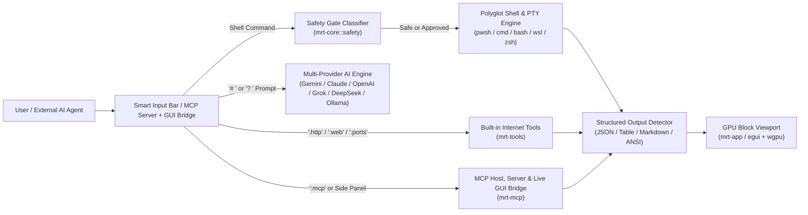

# MRT Architecture & Technical Guide

**Modern Rust Terminal (MRT)** is designed around a modular 5-crate Rust workspace so that the terminal core, internet tools, MCP engine, and multi-provider AI runtime can be tested independently and used in both GUI mode (`mrt`) and headless MCP Server mode (`mrt --mcp-server`).

---

## High-Level Data Flow

---

## Crate-by-Crate Breakdown

### 1. `mrt-core` — Polyglot Shell, Interactive PTYs, VT Parser, Blocks & Safety Gate
- **Multi-Shell Discovery (`discover_shells`)**: Automatically probes the OS and `PATH` for PowerShell 7 (`pwsh`), Windows PowerShell (`powershell`), Command Prompt / Batch (`cmd.exe`), Git Bash (`bash.exe`), WSL (`wsl.exe`), Bash, Zsh, Fish, Nushell (`nu`), and POSIX `sh`.
- **Interactive PTY Engine (`InteractivePty`)**: Wraps `portable-pty` for persistent interactive sessions with raw/line input (`\r\n` on Windows, `\n` on Unix), unread buffer draining, full transcript reading, dynamic resizing, exit polling, and process termination.
- **ANSI / VT100 Parser (`vt.rs`)**: Uses `vte` to parse SGR colors (16-color and 24-bit RGB truecolor), bold, italic, and underline attributes into `Vec<AnsiSpan>` while simultaneously producing clean plain text for structured output classification.
- **Structured Output Classifier (`block.rs`)**: Inspects completed command outputs and classifies them into:
  - `StructuredOutput::Json(Value)` — Rendered as an interactive collapsible tree.
  - `StructuredOutput::Table { headers, rows }` — Rendered as a striped, filterable grid.
  - `StructuredOutput::Markdown(String)` — Rendered with styled headings and bullet lists.
  - `StructuredOutput::HttpResult(HttpExchangeSummary)` — Rendered with status badge, latency, headers, and body tree.
  - `StructuredOutput::RawText` — Rendered with full ANSI styling.
- **Safety Approval Gate (`safety.rs`)**: Classifies commands into `Safe`, `Moderate`, or `Critical` across Unix, PowerShell, Windows Batch, Git, SQL, and Kubernetes. Critical commands require explicit user confirmation in the GUI and are blocked when invoked unapproved via MCP.

### 2. `mrt-tools` — Built-in Internet & Network Utilities
- **`http_inspector.rs`**: Executes REST/HTTP calls (`GET`, `POST`, `PUT`, `DELETE`, `PATCH`), measuring round-trip latency and auto-formatting JSON responses.
- **`web_fetch.rs`**: Fetches live web pages and converts HTML into clean Markdown (stripping `<script>`, `<style>`, `<svg>`).
- **`net_inspector.rs`**: Queries local listening sockets (`netstat -ano` on Windows, `/usr/sbin/lsof` on macOS, `ss -tulnp` on Linux/Unix) and returns a structured table of Protocol, Local Address, Port, State, and PID.

### 3. `mrt-mcp` — Dual-Mode Model Context Protocol & Live GUI Bridge
- **Live GUI Bridge (`bridge.rs`)**: Runs a localhost TCP JSON-RPC listener inside the MRT GUI (`mcp-bridge.json`), allowing external `mrt --mcp-server` processes to transparently control the live GUI window (and falling back to standalone headless mode when no GUI is running).
- **MCP Server (`server.rs`)**: Speaks JSON-RPC 2.0 over `stdio` (`mrt --mcp-server`), TCP bridge, or in-memory loopback. Exposes 24 tools covering session & multi-tab management (`mrt_get_session_state`, `mrt_list_tabs`, `mrt_create_tab`, `mrt_switch_tab`, `mrt_close_tab`, `mrt_configure_tab`), command execution & block inspection/diffing/AI triage (`mrt_run_command`, `mrt_list_blocks`, `mrt_get_block`, `mrt_search_blocks`, `mrt_compare_blocks`, `mrt_diagnose_block`, `mrt_clear_blocks`), interactive PTY sessions (`mrt_pty_spawn`, `mrt_pty_write`, `mrt_pty_read`, `mrt_pty_resize`, `mrt_pty_list`, `mrt_pty_kill`), live GUI control (`mrt_control_gui`), AI translation (`mrt_ai_translate`), and internet tools (`mrt_http_request`, `mrt_web_fetch`, `mrt_inspect_ports`), plus 4 MCP resources (`mrt://session/state`, `mrt://session/tabs`, `mrt://session/blocks`, `mrt://session/ptys`).
- **MCP Host (`client.rs`)**: Connects to external `stdio` MCP servers (`initialize` -> `tools/list` -> `tools/call`) and surfaces their tools inside the GUI's **MCP Hub**.

### 4. `mrt-ai` — Multi-Provider AI & Error Triage
- Supports **Google Gemini**, **Anthropic Claude**, **OpenAI**, **xAI Grok**, **DeepSeek**, **OpenRouter**, and **Local Ollama**, plus a built-in **Offline Polyglot Engine** that adapts commands to the active tab's shell (`cmd.exe` vs `pwsh` vs `bash`).
- Includes `diagnose_command_error` to explain failed commands (non-zero exit codes) and offer one-click shell-appropriate fixes.

### 5. `mrt-app` — Native GPU GUI (`eframe` / `egui`)
- Renders multi-shell tabs, **Mosaic** multi-terminal grid mode, **Folder Explorer**, persistent SQLite **Command History** and **Saved Runbooks** (with offline sequence editing, preview, Safety Gate enforcement, and stop-on-first-failure replay), the **Command Block** stream (with diff comparison), the **MCP Hub** (with Live GUI Bridge indicator) and **Internet Studio** side panels, the **Safety Approval Gate** modal, and the **Universal Command Palette** (`Ctrl+K` / `Ctrl+P`).
