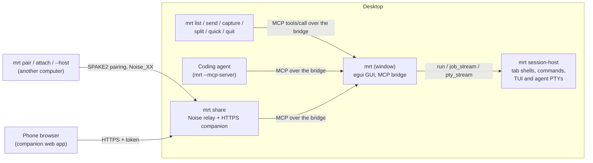
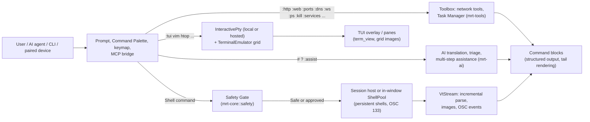

# MRT Architecture & Technical Guide

**Modern Rust Terminal (MRT)** is a 5-crate Rust workspace: the terminal core, the network and process tools, the MCP engine, the multi-provider AI runtime, and the GUI application can be tested on their own and used in several processes (the window, the session host, the headless MCP server, the CLI, the remote relay).

---

## Processes

- **The window** (`mrt`) draws the UI and owns the MCP state and the token-authenticated localhost **bridge** (`mcp-bridge.json`). A second `mrt` hands off to the running window (`cli::handoff_to_running_instance`); a newer version replaces an idle older window and leaves a busy one running.
- **The session host** (`mrt session-host`, `terminal.session_server`) owns the tabs' persistent shells, running commands, full-screen programs and agents' PTYs. The window follows them over event streams, and a new window reattaches after a close or crash. See [SESSION_SERVER.md](SESSION_SERVER.md).
- **`mrt server`** serves the MCP tools headless (CLI and agents without a window).
- **`mrt share`** is an encrypted relay in front of the bridge for paired devices, and with `--web` serves the phone companion over HTTPS.
- All data files live in `platform::data_dir()` (`$MRT_DATA_DIR` or the platform's local data folder).

## Data flow inside the window

---

## Crate-by-Crate Breakdown

### 1. `mrt-core` — shells, PTYs, terminal emulation, blocks, safety
- **Shell discovery and execution (`pty.rs`)**: finds PowerShell 7, Windows PowerShell, CMD, Git Bash, WSL, Bash, Zsh, Fish, Nushell and `sh`; runs one-off commands with 64 KiB streaming reads (`execute_command_streaming_with_pid`); `InteractivePty` has a local and a **hosted** backend (`pty_host.rs`) with the same API.
- **Git worktrees (`worktree.rs`)**: `create` (records the base branch), `list`, `changed_files`, `remove`, `review` (ahead/behind, commits, stat, colored diff), `discard`, and the merge and pull request command lines for each shell, over the `git` command line (no console window on Windows) for worktree tabs; worktrees go in `<repo>.worktrees/<branch>` next to the repository.
- **Persistent shells (`shell_session.rs`, `shell_integration.rs`)**: one PTY shell per tab with the OSC 133 / OSC 7 integration injected (or typed in over SSH, `spawn_remote`); the `Normalizer` turns ConPTY repaints back into text and passes OSC 8 / 52 / 1337, kitty APC and Sixel DCS through.
- **VT parsing (`vt.rs`, `images.rs`, `theme_file.rs`)**: `VtStream` parses streamed output chunk by chunk into styled spans, plain text, OSC events and inline images (iTerm2, kitty, Sixel); the ANSI palette can come from a theme file.
- **Terminal grid (`term.rs`, `grid_images.rs`)**: `TerminalEmulator` wraps `alacritty_terminal` for full-screen programs and places image sequences (taken out by `GraphicsSplitter`) in the grid.
- **Blocks (`block.rs`)**: `CommandBlock` with incremental `append_output`, a per-block output limit, inline images, and structured classification (JSON, CSV/TSV tables, Markdown, HTTP).
- **Safety Gate (`safety.rs`)**: Safe / Moderate / Critical across shells, Git, SQL, Kubernetes, process control and service control.
- **SSH hosts (`ssh_config.rs`)**: the `Host` aliases of `~/.ssh/config` (with `Include` files) for the Command Palette.
- **Activity (`activity.rs`), links (`links.rs`), configuration (`config.rs`), platform helpers (`platform.rs`)**: tab status from OSC 9;4 / OSC 678 / heuristics; URL and `path:line` detection; layered `config.toml` + `.mrt.toml` with a watcher (`[[actions]]`, `[[hooks]]`, keybindings, theme, fonts, limits); login-shell `PATH`, console attach and the data folder.

### 2. `mrt-tools` — network tools and Task Manager
- `http_inspector.rs`, `web_fetch.rs`, `net_inspector.rs`, `dns_inspector.rs`, `ws_inspector.rs`, `bug_reporter.rs`, `structured_diff.rs`: `:http`, `:web`, `:ports`, `:dns`, `:ws`, `:report`, `:diff`.
- `process_inspector.rs`: snapshots (`sysinfo`), `:ps`, `:top`, `:proc`, `:kill` planning and termination, `:watch-proc`.
- `process_control.rs`: `:suspend`, `:resume`, `:priority` (NtSuspendProcess / SetPriorityClass, SIGSTOP / setpriority).
- `service_inspector.rs`: `:services` and `:service start|stop|restart` through the Safety Gate.

### 3. `mrt-mcp` — MCP server and host, bridge, remote access
- `server.rs`: 31 tools and 5 resources (tabs, commands and blocks, PTYs, GUI control including window and Safety Gate answers, AI translation, network tools, Task Manager), sandbox tabs.
- `bridge.rs`: the token-authenticated localhost bridge to the running window.
- `client.rs`, `transport.rs`: MCP host for external servers over stdio and Streamable HTTP.
- `remote.rs`: `mrt share` relay (SPAKE2 pairing, Noise_XX, paired keys, revocation); `companion.rs`: HTTPS phone companion.

### 4. `mrt-ai` — AI providers and assistance
- `lib.rs`: Gemini, Anthropic, OpenAI, xAI, DeepSeek, OpenRouter, Ollama and the offline engine; translation and streamed error diagnosis.
- `assist.rs`: `:assist` multi-step investigations over MRT's read-only MCP tools (model-driven, or a built-in offline plan).
- `usage.rs`: token use and estimated cost of every request (`[ai.prices]`).
- `keys.rs`: API keys from the environment, then the OS keyring (`keyring`: Windows Credential Manager, macOS Keychain, Secret Service over zbus).

### 5. `mrt-app` — the GUI and the command-line entry points
- `main.rs` dispatches `mrt` subcommands (`agent`, `list|send|capture|split|quick|quit`, `share|pair|attach`, `server`, `session-host`, `--mcp-server`) before starting the window.
- `app.rs`: tabs, panes, Mosaic, blocks, TUI overlay and pane programs, Safety Gate modal, Command Palette, remote, sandbox and worktree tabs, `:assist`, background mode and reattach.
- `windows.rs` (extra windows as egui viewports, each drawing its own tabs), `settings.rs` (the settings window, writing `config.toml` with `toml_edit`), `update_check.rs` (the opt-in GitHub Releases check).
- `session_host.rs` (the host process and its client), `shell_pool.rs` (in-window persistent shells and SSH sessions), `layout.rs`, `cli.rs`, `remote_cli.rs`, `server.rs`.
- `keymap.rs`, `copy_mode.rs`, `hooks.rs`, `find.rs`, `fonts.rs`, `theme.rs`, `config_runtime.rs`, `notifications.rs`, `history.rs`, `term_input.rs`, and `widgets/` (block view with tail rendering and images, term view with grid images, links, activity, toolbox, task manager, side panels).

---

## Build, Tests, CI & Release

- **Tests**: `RUSTFLAGS="-D warnings" cargo test --workspace --locked` runs unit tests in every crate and `crates/mrt-app/tests/e2e_processes.rs`, which starts real `mrt` processes (`server`, `share`, `pair`, `--host`, `session-host`) with separate `MRT_DATA_DIR`s. `scripts/e2e/` drives the real window on an offscreen X server (crash and reattach, feature tour).
- **CI (`.github/workflows/ci.yml`)**: the same test command on Ubuntu, Windows and macOS for pushes to `main` and pull requests. *Currently disabled in the repository settings (no GitHub Actions minutes); run the tests locally before merging.*
- **Benchmarks (`.github/workflows/bench.yml`)**: manual `criterion` throughput suite; see [PERFORMANCE.md](PERFORMANCE.md).
- **Release (`.github/workflows/release.yml`)**: on `v*` tags, release builds for Windows (ZIP), Linux and macOS Intel / Apple Silicon (tar.gz) attached to the GitHub Release. *Currently disabled (no Actions minutes): every release since v0.2.0 is published with Windows and Linux archives built locally (`cargo build --release --locked` on Windows, `scripts/release/build-linux.sh` for Linux; see [CONTRIBUTING.md](../CONTRIBUTING.md#building-release-archives)).*
- **Icon and packaging metadata**: `scripts/icons/make_icon.py` draws the icon (the sidebar's `›_` brand mark) into `crates/mrt-app/assets/mrt.ico` (embedded in `mrt.exe` by `crates/mrt-app/build.rs` with `mrt.rc`, together with the version information), `assets/mrt-256.png` (the window and taskbar icon, `ViewportBuilder::with_icon`) and `packaging/linux/mrt.png`. `packaging/linux/mrt.desktop` (`Icon=mrt`, `StartupWMClass=mrt`, matching the window's app id) and the icon ship in the Linux archive; `packaging/macos/Info.plist` is not used yet.
