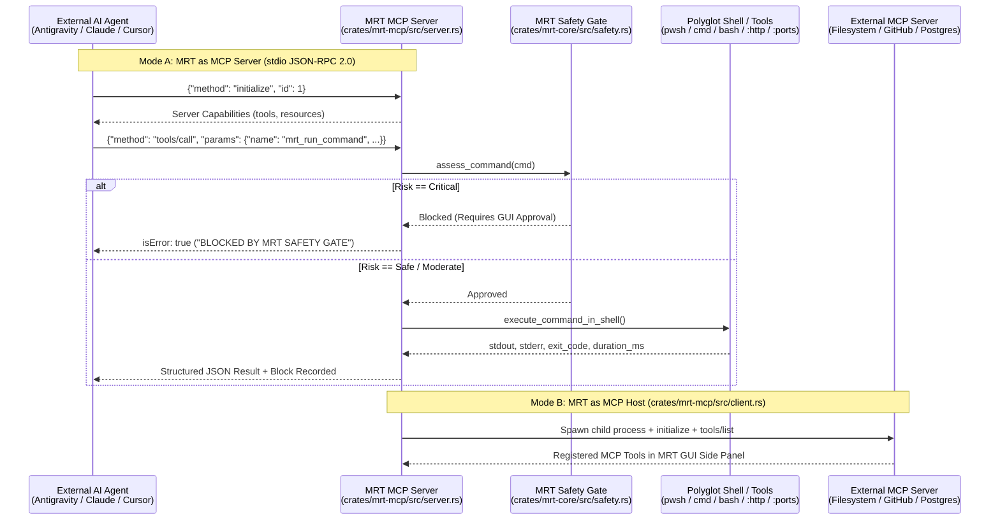

# 🔌 In-Depth MCP Guide (`mrt-mcp`)

**Modern Rust Terminal (MRT)** implements a **Dual-Mode Model Context Protocol (MCP)** engine in [`crates/mrt-mcp`](../crates/mrt-mcp). MRT is both:
1. **An MCP Server (`mrt --mcp-server`)**: Exposes your terminal's live session state, multi-shell command execution (protected by the MRT Safety Gate), block history, and built-in internet tools to external AI agents (Antigravity, Claude Desktop, Cursor, Windsurf, Codex, OpenHands).
2. **An MCP Host / Client**: Connects to external MCP servers (`stdio` JSON-RPC 2.0) directly inside the MRT GUI's **MCP Hub** side panel and makes their tools callable from your terminal blocks and AI assistant.

---

## 1. Architecture Overview



---

## 2. Using MRT as an MCP Server (`mrt --mcp-server`)

When launched with `--mcp-server`, MRT runs headlessly with zero GUI overhead, reading newline-delimited JSON-RPC 2.0 requests from `stdin` and writing JSON-RPC 2.0 responses to `stdout` (protocol version `2024-11-05`).

### Client Configuration Examples (Antigravity, Claude Desktop, Cursor)

Add the following entry to your AI client's `mcpServers` configuration file (e.g., `claude_desktop_config.json`, `.cursor/mcp.json`, or Antigravity MCP settings):

```json
{
  "mcpServers": {
    "modern-rust-terminal": {
      "command": "C:/Users/YourUser/Documents/MRT/target/debug/mrt.exe",
      "args": ["--mcp-server"]
    }
  }
}
```
*(On Linux/macOS, point `"command"` to `/path/to/MRT/target/release/mrt`.)*

---

## 3. Complete MCP Server Tool Reference

All built-in tools are defined in [`MrtMcpServerState::built_in_tools()`](../crates/mrt-mcp/src/server.rs).

### 3.1 `mrt_get_session_state`
Returns the host OS, CPU architecture, current working directory (`cwd`), discovered shells on the system, and number of recorded command blocks.

- **Input Schema**: `{}` (no required parameters)
- **Example JSON-RPC Request**:
  ```json
  {"jsonrpc":"2.0","id":1,"method":"tools/call","params":{"name":"mrt_get_session_state","arguments":{}}}
  ```
- **Example Output Payload**:
  ```json
  {
    "arch": "x86_64",
    "available_shells": [
      { "id": "pwsh", "name": "PowerShell 7 (pwsh)", "program": "pwsh.exe" },
      { "id": "powershell", "name": "Windows PowerShell", "program": "powershell.exe" },
      { "id": "cmd", "name": "Command Prompt / Batch (cmd.exe)", "program": "cmd.exe" },
      { "id": "git-bash", "name": "Git Bash (MINGW64)", "program": "C:\\Program Files\\Git\\bin\\bash.exe" },
      { "id": "wsl", "name": "WSL (Linux Subsystem)", "program": "wsl.exe" }
    ],
    "block_count": 4,
    "cwd": "C:\\Users\\Danie\\Documents\\MRT",
    "os": "windows"
  }
  ```

### 3.2 `mrt_run_command`
Executes a command in any discovered shell on the host (`pwsh`, `powershell`, `cmd`, `git-bash`, `wsl`, `bash`, `zsh`, `fish`, `nu`, `sh`), updates the session `cwd` if `cd` is used, appends a new `CommandBlock` to history, and returns the output.

- **Safety Gate Protection**: Every command is first checked by `mrt_core::assess_command`. If a command is classified as `RiskLevel::Critical` (e.g., `rm -rf`, `Remove-Item -Recurse -Force`, `del /s /q`, `DROP TABLE`, `git reset --hard`), `mrt_run_command` immediately rejects it with `isError: true`.
- **Input Schema**:
  | Field | Type | Required | Description |
  | :--- | :--- | :--- | :--- |
  | `command` | `string` | **Yes** | The shell command string to execute. |
  | `shell` | `string` | No | Target shell ID (`"pwsh"`, `"powershell"`, `"cmd"`, `"git-bash"`, `"wsl"`, `"bash"`, `"zsh"`). Defaults to the primary discovered shell. |
- **Example JSON-RPC Request**:
  ```json
  {
    "jsonrpc": "2.0",
    "id": 2,
    "method": "tools/call",
    "params": {
      "name": "mrt_run_command",
      "arguments": {
        "command": "cargo --version",
        "shell": "powershell"
      }
    }
  }
  ```

### 3.3 `mrt_list_blocks`
Retrieves recent executed `CommandBlock` items from the session history, including their detected structured output type (`JSON Tree`, `Interactive Table`, `Markdown View`, `HTTP Inspector`, or `ANSI Text`).

- **Input Schema**:
  | Field | Type | Required | Description |
  | :--- | :--- | :--- | :--- |
  | `limit` | `integer` | No | Maximum number of most-recent blocks to return (default: `10`). |

### 3.4 `mrt_http_request`
Executes an outbound HTTP/REST call via `mrt-tools::http_inspector` and returns the status code, status text, latency in milliseconds, response headers, and parsed JSON/raw body.

- **Input Schema**:
  | Field | Type | Required | Description |
  | :--- | :--- | :--- | :--- |
  | `url` | `string` | **Yes** | Target URL (`https://...`). |
  | `method` | `string` | No | HTTP verb (`GET`, `POST`, `PUT`, `DELETE`, `PATCH`). Defaults to `GET`. |
  | `body` | `string` | No | Optional request payload (automatically sets `Content-Type: application/json`). |

### 3.5 `mrt_web_fetch`
Fetches a web URL via `mrt-tools::web_fetch` and converts its HTML into clean, readable Markdown (stripping scripts, styles, and navigation noise).

- **Input Schema**:
  | Field | Type | Required | Description |
  | :--- | :--- | :--- | :--- |
  | `url` | `string` | **Yes** | Web URL to fetch and convert to Markdown. |

### 3.6 `mrt_inspect_ports`
Runs MRT's cross-platform listening port scanner (`mrt-tools::net_inspector`) and returns active local TCP/UDP listening ports and PIDs in CSV format.

- **Input Schema**: `{}`

---

## 4. MCP Resources Exposed by MRT

External MCP clients can also subscribe to or read two native MCP resources via `resources/list` and `resources/read`:

| Resource URI | MIME Type | Description |
| :--- | :--- | :--- |
| `mrt://session/state` | `application/json` | Live JSON snapshot of OS, architecture, active CWD, and discovered shells. |
| `mrt://session/blocks` | `application/json` | Full serialized array of `CommandBlock` structs in the current session. |

---

## 5. Using MRT as an MCP Host (`crates/mrt-mcp/src/client.rs`)

Inside the MRT GUI, open the **🔌 MCP Hub** side panel on the right:
1. **Built-in Loopback Server (`mrt-native-mcp`)**: Connected automatically on startup so you can test and invoke all 6 MRT MCP tools with one click right from the GUI.
2. **Connecting External Stdio MCP Servers**:
   - Enter a **Name** (e.g., `filesystem`), **Command** (e.g., `npx`), and **Args** (e.g., `-y @modelcontextprotocol/server-filesystem .`), then click **➕ Connect MCP Server**.
   - `McpHostManager::connect_external_stdio_server` spawns the server (with `CREATE_NO_WINDOW` on Windows so no console window flashes), performs the `initialize` and `tools/list` handshake, and renders every discovered tool in the side panel.
   - Clicking **▶ Invoke Tool** executes `tools/call` and renders the returned MCP content directly as a structured `CommandBlock` in your active terminal tab!

---

## 6. How Contributors Can Add a New Built-in MCP Tool

To add a new MCP tool to MRT:
1. Open [`crates/mrt-mcp/src/server.rs`](../crates/mrt-mcp/src/server.rs).
2. Add a new `McpTool` definition inside `MrtMcpServerState::built_in_tools()` with its `name`, `description`, and JSON Schema `input_schema`.
3. Add a matching arm inside `execute_mrt_mcp_tool(state, tool_name, args)` that performs the work and returns `McpToolCallResult::text(output, is_error)`.
4. Add a unit test in `crates/mrt-mcp/src/client.rs` under `mod tests` and run `cargo test -p mrt-mcp`.
