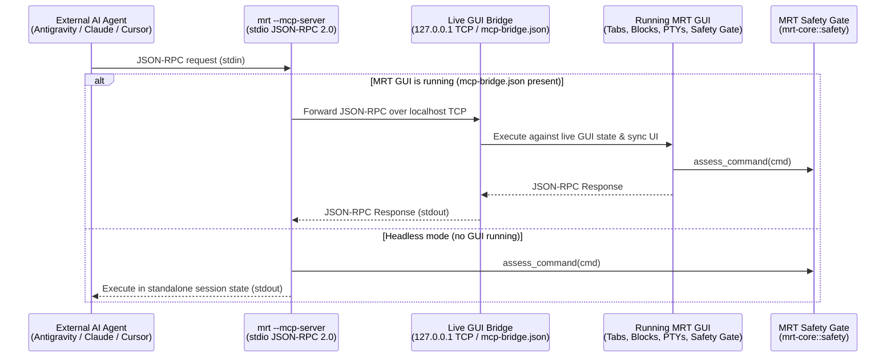

# In-Depth MCP Guide (`mrt-mcp`)

**Modern Rust Terminal (MRT)** implements a **Dual-Mode Model Context Protocol (MCP)** engine in [`crates/mrt-mcp`](../crates/mrt-mcp). MRT acts as both:
1. **An MCP Server (`mrt --mcp-server` + Live GUI Bridge)**: Exposes multi-tab session management, polyglot command execution (protected by the MRT Safety Gate), interactive PTY sessions, block inspection/diffing/AI diagnosis, live GUI control, built-in network tools, and a Task Manager to external AI agents (Antigravity, Claude Desktop, Cursor, Windsurf, Codex, OpenHands).
2. **An MCP Host / Client**: Connects to external MCP servers (`stdio` JSON-RPC 2.0) directly inside the MRT GUI's **MCP Hub** side panel and makes their tools callable from your terminal blocks and AI assistant.

---

## 1. Dual-Mode Architecture (Live GUI Bridge + Headless Mode)



### How the Live GUI Bridge Works
- When you launch the MRT desktop GUI (`mrt`), it automatically starts a local loopback TCP listener (`127.0.0.1:<port>`) in [`crates/mrt-mcp/src/bridge.rs`](../crates/mrt-mcp/src/bridge.rs) and writes the port and a random per-session token to `mcp-bridge.json` in the local MRT data directory (`0600` on macOS/Linux, per-user `%LOCALAPPDATA%` on Windows; removed cleanly on exit).
- Every bridge connection must first send `{"mrt_bridge_auth":"<token>"}` on its own line. Connections without the right token get a `-32001 Unauthorized` error and are closed, so other local programs cannot drive the GUI just by finding the port.
- When an external AI client spawns `mrt --mcp-server`, MRT reads the port and token from a live `mcp-bridge.json` (or the `MRT_MCP_BRIDGE_PORT` + `MRT_MCP_BRIDGE_TOKEN` env vars). If a GUI window is open, requests are transparently proxied to the live GUI so agents can create/switch tabs, run commands visible in your blocks, inspect your existing output, or toggle Mosaic/Explorer views in real time.
- If no GUI window is open, `mrt --mcp-server` seamlessly runs in standalone headless mode with its own multi-tab and PTY state.

---

## 2. Connecting External AI Clients (`mrt --mcp-server`)

Open the **MCP Hub** side panel inside MRT and click **Copy MCP Config**, or add the following to your AI client's `mcpServers` configuration file (e.g., `claude_desktop_config.json`, `.cursor/mcp.json`, or Antigravity MCP settings):

```json
{
  "mcpServers": {
    "modern-rust-terminal": {
      "command": "C:/Users/YourUser/Documents/MRT/target/debug/mrt.exe",
      "args": ["--mcp-server"]
    }
  }
}
```
*(On Linux/macOS, point `"command"` to `/path/to/MRT/target/release/mrt`. The **Copy MCP Config** button fills in the path of the running executable for you.)*

### 2.1 One-command setup for coding agents (`mrt agent setup`)

```bash
mrt agent setup                    # Claude Code, Codex CLI and Gemini CLI, user-level files
mrt agent setup --agent codex      # one agent (comma-separated list or "all")
mrt agent setup --project          # files in the current directory instead
mrt agent setup --dry-run          # print what would change, write nothing
mrt agent show                     # MCP command line + instructions, for any other agent
mrt agent remove                   # undo setup (takes the same flags)
```

For each agent, `setup` does two things:

1. Adds an MCP server named `mrt` that starts `<path of this mrt binary> --mcp-server`.
2. Writes an `mrt` skill (`skills/mrt/SKILL.md`) that tells the agent what MRT's tools are for and that commands go through the Safety Approval Gate: when a command is blocked it must not retry it in another form, but ask the user, who can approve it in the MRT window.

| Agent | Scope | MCP server entry | Skill |
| :--- | :--- | :--- | :--- |
| Claude Code | `--user` (default) | `~/.claude.json` → `mcpServers.mrt` (`type: "stdio"`) | `~/.claude/skills/mrt/SKILL.md` |
| Claude Code | `--project` | `.mcp.json` → `mcpServers.mrt` | `.claude/skills/mrt/SKILL.md` |
| Codex CLI | `--user` | `$CODEX_HOME/config.toml` (default `~/.codex/config.toml`) → `[mcp_servers.mrt]` | `~/.agents/skills/mrt/SKILL.md` |
| Codex CLI | `--project` | `.codex/config.toml` → `[mcp_servers.mrt]` (Codex reads it in trusted projects only) | `.agents/skills/mrt/SKILL.md` |
| Gemini CLI | `--user` | `~/.gemini/settings.json` → `mcpServers.mrt` | `~/.gemini/skills/mrt/SKILL.md` |
| Gemini CLI | `--project` | `.gemini/settings.json` → `mcpServers.mrt` | `.gemini/skills/mrt/SKILL.md` |

Sources: Claude Code [MCP scopes](https://code.claude.com/docs/en/mcp) and [skills](https://code.claude.com/docs/en/skills); Codex [MCP](https://developers.openai.com/codex/mcp) and [skills](https://developers.openai.com/codex/skills); Gemini CLI [MCP servers](https://geminicli.com/docs/tools/mcp-server/) and [skills](https://geminicli.com/docs/cli/skills/).

How it treats your files:

- **Merges, never replaces.** Only the `mrt` entry is added or updated; other servers and settings stay. TOML comments and layout are kept. JSON files are rewritten with two-space indentation and keys in alphabetical order (the content is otherwise the same).
- **Backs up first.** Before changing an existing config file it copies it to `<file>.mrt-backup-<date>-<time>` in the same folder.
- **Idempotent.** Running `setup` again changes nothing. If the `mrt` binary moved, it updates the path and keeps any keys you added to the entry (such as `env`).
- **Leaves other tools' entries alone.** If an `mrt` server that does not start an `mrt` binary with `--mcp-server`, or an `mrt` skill MRT did not write, already exists, it is reported as *skipped* and not touched.
- **`remove` undoes exactly what `setup` added**: it deletes the `mrt` server entry (and the `mcpServers` / `mcp_servers` table if that leaves it empty, and the file if that leaves it empty), the skill file MRT wrote, and any folders that are left empty.
- Close the agent before running setup on `~/.claude.json`, which Claude Code also rewrites, then start it again to load the server and skill.

---

## 3. Complete MCP Server Tool Reference (31 Tools)

All built-in tools are defined in [`MrtMcpServerState::built_in_tools()`](../crates/mrt-mcp/src/server.rs).

### 3.1 Session & Multi-Tab Management

| Tool | Description | Key Parameters |
| :--- | :--- | :--- |
| **`mrt_get_session_state`** | Returns OS, arch, active CWD, active tab ID, all open tabs (each with its `activity`), active PTY count, GUI attachment flag, and available shells. | *(none)* |
| **`mrt_list_tabs`** | Lists all terminal tabs with index, UUID, title, active status, shell ID/name, CWD, block count, and `activity`. | *(none)* |
| **`mrt_create_tab`** | Opens a new terminal tab with optional title, shell profile, working directory, and focus activation. | `title?`, `shell?`, `cwd?`, `activate?` (default `true`) |
| **`mrt_switch_tab`** | Switches the active terminal tab by UUID, 0-based index, or title substring. | `tab_id` *(required)* |
| **`mrt_close_tab`** | Closes a tab by UUID, index, or title substring (always keeps at least 1 tab open). | `tab_id` *(required)* |
| **`mrt_configure_tab`** | Updates a tab's shell profile, working directory (`cwd`), or title. | `tab_id?`, `shell?`, `cwd?`, `title?` |
| **`mrt_control_gui`** | Controls the live MRT GUI: sets/submits the prompt bar (honoring the GUI Safety Gate modal), toggles Mosaic mode with its arrangement (`grid`, `columns`, `rows`, `focus`) and grid columns, toggles the Folder Explorer, or opens the Toolbox panel on a tab (`"network"`, `"task_manager"`, `true`/`false`, `"hidden"`). | `tab_id?`, `input_text?`, `submit_input?`, `mosaic?`, `mosaic_columns?`, `mosaic_layout?`, `explorer?`, `toolbox?` |

Each tab entry in `mrt_list_tabs`, `mrt_get_session_state` and the `mrt://session/tabs` resource carries an `activity` object, so an orchestrating agent can see which tabs are busy, blocked or done:

```json
"activity": {
  "state": "waiting_for_input",
  "label": "Waiting for input",
  "progress": null,
  "tone": "normal",
  "agent": "claude",
  "detail": "Last line: Do you want to proceed?",
  "command": "claude"
}
```

`state` is one of `idle`, `running`, `progress` (then `progress` holds 0–100), `waiting_for_input`, `succeeded`, `failed`. `tone` is `normal`, `error` or `warning` (from `OSC 9;4` states 2 and 4). `agent` names a recognised agent CLI (`claude`, `codex`, `gemini`, `aider`) or is `null`. With a live GUI the values come from the GUI's per-tab tracker; a headless `mrt --mcp-server` derives them from the tab's blocks (running, or the last exit code). The states, heuristics and the `OSC 678` status sequence are described in the [User Guide](USER_GUIDE.md#tab-activity-status).

### 3.2 Command Execution & Block Inspection

| Tool | Description | Key Parameters |
| :--- | :--- | :--- |
| **`mrt_run_command`** | Executes a command in a target tab and shell (`pwsh`, `powershell`, `cmd`, `bash`, `git-bash`, `wsl`, `zsh`, `fish`, `nu`, `sh` — whichever are installed) with MRT Safety Gate protection, recording a `CommandBlock`. | `command` *(required)*, `shell?`, `tab_id?`, `cwd?` |
| **`mrt_list_blocks`** | Lists recent `CommandBlock` summaries (ID, tab, command, shell, CWD, exit code, duration, structured type, output). | `tab_id?`, `limit?` (default `10`) |
| **`mrt_get_block`** | Retrieves full details of a `CommandBlock` by UUID, including structured payload (`Json`, `Table`, `Markdown`, `HttpResult`), raw ANSI, plain text, and AI triage. | `block_id` *(required)* |
| **`mrt_search_blocks`** | Searches and filters blocks across tabs by command/output substring or non-zero exit codes. | `query?`, `tab_id?`, `failed_only?`, `limit?` (default `20`) |
| **`mrt_compare_blocks`** | Computes a line-by-line unified diff between two `CommandBlock`s and optionally opens the visual comparison view in the MRT GUI. | `previous_block_id` *(required)*, `current_block_id` *(required)*, `show_in_gui?` (default `true`) |
| **`mrt_diagnose_block`** | Runs MRT's shell-aware AI Error Triage on a `CommandBlock` and attaches the explanation and suggested fix to the block. | `block_id` *(required)* |
| **`mrt_clear_blocks`** | Clears command blocks in a target tab or across all tabs (`all: true`). | `tab_id?`, `all?` |

> **Safety Gate Protection**: `mrt_run_command`, `mrt_pty_spawn`, and `mrt_pty_write` evaluate commands with `mrt_core::assess_command`. Commands classified as `RiskLevel::Critical` (e.g., `rm -rf`, `Remove-Item -Recurse -Force`, `del /s /q`, `DROP TABLE`, `git reset --hard`) are blocked with `isError: true`. When using `mrt_control_gui` with `submit_input: true`, `Critical` commands trigger the interactive Safety Approval Gate modal inside the MRT GUI for human confirmation. Process-control commands (`kill`, `pkill`, `taskkill`, `Stop-Process`, …) aimed at OS-critical processes are Critical too; use `mrt_kill_process` to stop processes through the Gate.

### 3.3 Interactive PTY & Background Process Control

| Tool | Description | Key Parameters |
| :--- | :--- | :--- |
| **`mrt_pty_spawn`** | Spawns a persistent interactive PTY session (for REPLs, dev servers, SSH, watchers, or interactive CLI prompts) and returns its `pty_id`. | `shell?`, `command?`, `cwd?`, `cols?` (default `120`), `rows?` (default `36`), `wait_ms?` (default `150`) |
| **`mrt_pty_write`** | Sends text, commands, or control sequences (e.g. `\u0003` for Ctrl+C) to a running PTY session and returns newly produced output. | `pty_id` *(required)*, `input` *(required)*, `append_newline?` (default `true`), `wait_ms?` (default `150`) |
| **`mrt_pty_read`** | Reads a PTY session. `view: "output"` (default) returns its output: the unread part or the full transcript, with optional ANSI stripping. `view: "screen"` returns what the terminal shows now: `screen` (one string per row, trailing spaces trimmed), `cursor` (`row`, `col`, `visible`, 0-based), `alt_screen`, `title`, `cols`, `rows`. It is rebuilt by replaying the session's transcript into a terminal emulator at the current size, so use it to drive full-screen programs (vim, htop, less). | `pty_id` *(required)*, `view?` (`output` / `screen`), `drain?` (default `true`), `strip_ansi?` (default `true`), `wait_ms?` (default `0`) |
| **`mrt_pty_resize`** | Resizes an active PTY session's terminal dimensions. | `pty_id` *(required)*, `cols` *(required)*, `rows` *(required)* |
| **`mrt_pty_list`** | Lists all active and exited interactive PTY sessions with running status and exit codes. | *(none)* |
| **`mrt_pty_kill`** | Terminates a running PTY session and optionally removes it from the session table. | `pty_id` *(required)*, `remove?` (default `true`) |

### 3.4 AI & Built-in Internet / Diagnostic Tools

| Tool | Description | Key Parameters |
| :--- | :--- | :--- |
| **`mrt_ai_translate`** | Translates a natural-language task into an idiomatic command for the target shell using MRT's multi-provider AI / polyglot engine. | `query` *(required)*, `shell?` |
| **`mrt_http_request`** | Performs an HTTP/REST request via `mrt-tools::http_inspector` and returns status, latency, headers, and formatted body. | `url` *(required)*, `method?` (default `GET`), `body?` |
| **`mrt_web_fetch`** | Fetches a web URL and converts its HTML into clean readable Markdown. | `url` *(required)* |
| **`mrt_inspect_ports`** | Lists active local listening TCP/UDP ports and PIDs on the host system in CSV format. | *(none)* |
| **`mrt_inspect_dns`** | Resolves IPv4 (A) and IPv6 (AAAA) records, calculates lookup duration, and measures TCP handshake latency to all endpoints. | `host` *(required)*, `port?` |
| **`mrt_generate_bug_report`** | Generates a GitHub-flavored Markdown issue report for a failed command block with automatic secret token redaction. | `block_id` *(required)* |
| **`mrt_inspect_ws`** | Connects to a WebSocket endpoint (`ws://` or `wss://`), measures handshake latency, logs frames with timestamps, and optionally sends an initial probe frame. | `url` *(required)*, `initial_message?`, `timeout_ms?` (default `3000`) |

### 3.5 Task Manager & Process Control

| Tool | Description | Key Parameters |
| :--- | :--- | :--- |
| **`mrt_list_processes`** | Lists running processes (PID, parent, name, CPU %, memory, user, status, command line) with `mrt_owner` naming the MRT tab, TUI overlay or PTY that started each one. | `filter?`, `sort?` (`cpu`, `mem`, `pid`, `name`), `limit?` (default `50`), `tree?`, `only_mrt?` |
| **`mrt_inspect_process`** | Details of one process: command line, executable, working directory, user, CPU/memory, ancestors, child tree, listening ports, MRT ownership. | `pid` *(required)* |
| **`mrt_kill_process`** | Requests stopping processes through the Safety Approval Gate. Critical targets (OS processes, MRT itself or its parents, other users' processes, names matching several PIDs) are always blocked. With the GUI attached, the request opens the approval modal and returns `pending_approval`; headless, only processes MRT started can be stopped. | `pid?` or `name?`, `force?`, `tree?` |
| **`mrt_compare_process_snapshots`** | Lists processes that started, exited or grew in memory, between two `:ps` blocks or between now and the baseline saved by the previous call. | `previous_block_id?`, `current_block_id?`, `reset_baseline?` |

See the [Toolbox guide](TOOLBOX.md#6-task-manager--process-tools-process_inspectorrs) for the classification rules.

---

## 4. MCP Resources Exposed by MRT

External MCP clients can list and read five native MCP resources via `resources/list` and `resources/read`:

| Resource URI | MIME Type | Description |
| :--- | :--- | :--- |
| `mrt://session/state` | `application/json` | Live JSON snapshot of OS, architecture, active CWD, active tab ID, tab/PTY counts, GUI attachment status, and discovered shells. |
| `mrt://session/tabs` | `application/json` | Structured list of all open terminal tabs, active shell per tab, CWD, and block counts. |
| `mrt://session/blocks` | `application/json` | Full serialized array of `CommandBlock` structs in the current session. |
| `mrt://session/ptys` | `application/json` | Active and exited interactive PTY sessions with dimensions and exit status. |
| `mrt://processes` | `application/json` | Top 100 running processes by CPU with memory, user, command line, and the MRT tab/PTY that started each one. |

---

## 5. Using MRT as an MCP Host (`crates/mrt-mcp/src/client.rs`)

Inside the MRT GUI, open the **MCP Hub** side panel on the right:
1. **Live GUI Bridge Indicator**: Shows the active `127.0.0.1:<port>` bridge address and a **Copy MCP Config** button for external agents.
2. **Built-in Loopback Server (`mrt-native-mcp`)**: Connected automatically on startup so you can test and invoke all 31 MRT MCP tools directly from the GUI.
3. **One-Click Server Presets**:
   - Quick-load preconfigured profiles for popular MCP servers:
     - **Filesystem**: `@modelcontextprotocol/server-filesystem`
     - **Git**: `mcp-server-git`
     - **Memory Graph**: `@modelcontextprotocol/server-memory`
     - **SQLite**: `mcp-server-sqlite`
     - **Fetch**: `mcp-server-fetch`
4. **Connecting External Stdio MCP Servers**:
   - Enter a **Name** (e.g., `filesystem`), **Command** (e.g., `npx`), and **Args** (e.g., `-y @modelcontextprotocol/server-filesystem .`), then click **Connect MCP Server**.
   - `McpHostManager::connect_external_stdio_server` spawns the server (with `CREATE_NO_WINDOW` on Windows so no console window flashes), performs the `initialize` and `tools/list` handshake, and renders every discovered tool in the side panel.
   - Clicking **Invoke Tool** executes `tools/call` and renders the returned MCP content directly as a `CommandBlock` in your active terminal tab.

### 5.1 Remote (HTTP) servers

Besides `stdio`, the MCP Hub connects to remote MCP servers over **Streamable HTTP**. In the connect form, set **Transport** to `HTTP` and fill in a **Name**, the server's MCP endpoint **URL** (e.g., `https://example.com/mcp`) and optional **Headers**, one `Name: value` per line (e.g., `Authorization: Bearer <token>`). The headers box is masked unless **Show** is ticked. Errors such as a bad URL, an HTTP 401 or an invalid header line show as a red server row.

External servers keep one **live session**: a stdio server keeps running between tool calls, and an HTTP server keeps its `Mcp-Session-Id`.

#### Transports (`crates/mrt-mcp/src/transport.rs`)

Both transports sit behind one `Transport` type; the session logic in `client.rs` (`McpClientSession`: request ids, `initialize`, paginated `*/list`, `tools/call`, 300 s request timeout) is shared.

| | stdio | Streamable HTTP |
| :--- | :--- | :--- |
| Framing | One JSON-RPC message per line on the child's stdin/stdout. Non-JSON lines are skipped. | Every message is a `POST` to the single MCP endpoint with `Accept: application/json, text/event-stream`. |
| Responses | The line whose `id` matches. | Either one `application/json` body or a `text/event-stream` (SSE) stream; MRT reads the stream until the matching response arrives. Notifications MRT sends get `202 Accepted`. |
| Session | The child process. | `Mcp-Session-Id` from the `initialize` response, sent on every later request. `MCP-Protocol-Version: <negotiated version>` is sent on every request after `initialize`. |
| Server-initiated messages | Read between responses. | Read from SSE responses and from the optional `GET` listen stream MRT opens after initialization (a `405` answer means the server has none). |
| Session lost | Child exited → MRT respawns it and retries the call once. | `404` while a session id is set → MRT sends `DELETE`, re-initializes and retries the call once. |
| Broken stream | — | An SSE response that closes before its result is resumed with `GET` + `Last-Event-ID`, honouring the server's `retry:` delay (up to 5 times). |

MRT implements the Streamable HTTP transport of MCP revision [2025-11-25](https://modelcontextprotocol.io/specification/2025-11-25/basic/transports#streamable-http) and offers protocol version `2025-11-25` in `initialize` (the server may negotiate an older one). The newer stateless revision 2026-07-28 (no `initialize`, no `Mcp-Session-Id`) is not supported yet.

Server requests: MRT answers `ping` with an empty result and declines everything else (sampling, roots, elicitation) with `-32601`. Notifications and requests are kept (newest 200 per server) and can be read with `McpHostManager::drain_server_events(server_name)`.

**Header secrecy**: header values are never logged, never put into error messages, and `McpHttpHeader`'s `Debug` output prints `<redacted>`. The server row shows only the URL and header *names*. MRT refuses headers it manages itself (`Accept`, `Content-Type`, `Mcp-Session-Id`, `MCP-Protocol-Version`, `Last-Event-ID`, …).

The HTTP transport is tested in [`crates/mrt-mcp/tests/http_transport.rs`](../crates/mrt-mcp/tests/http_transport.rs) against a small in-test HTTP MCP server. The tests cover JSON and SSE responses, session reuse and expiry, stream resumption and header redaction.

---

## 6. How Contributors Can Add a New Built-in MCP Tool

To add a new MCP tool to MRT:
1. Open [`crates/mrt-mcp/src/server.rs`](../crates/mrt-mcp/src/server.rs).
2. Add a new `McpTool` definition inside `MrtMcpServerState::built_in_tools()` with its `name`, `description`, and JSON Schema `input_schema`.
3. Add a matching arm inside `execute_mrt_mcp_tool(state, tool_name, args)` that performs the work, notifies the GUI via `state.notify_gui(...)` if state changed, and returns `McpToolCallResult::text(output, is_error)`.
4. Add a unit test in [`crates/mrt-mcp/src/client.rs`](../crates/mrt-mcp/src/client.rs) under `mod tests` and run `cargo test -p mrt-mcp`.
